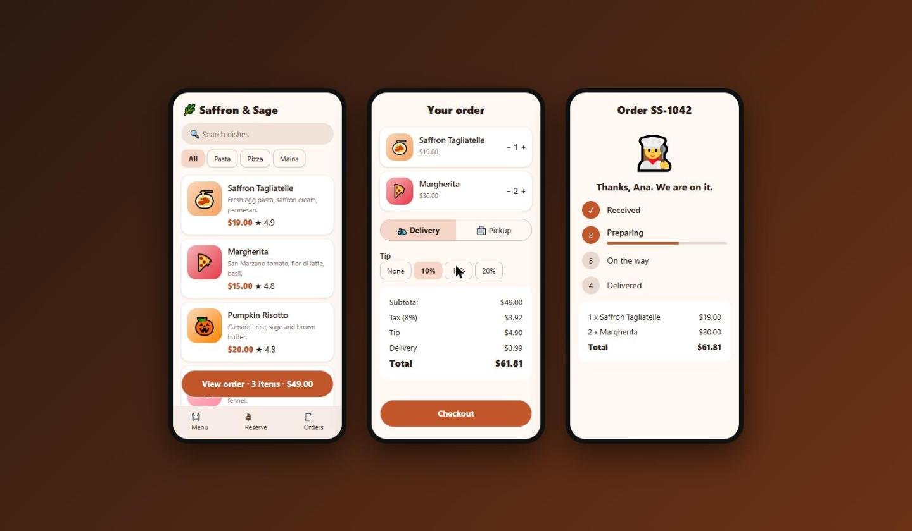

# 🍽️ Flutter Restaurant App

A free Flutter template for a restaurant: browse the menu, order for delivery or pickup, follow the order status live, and book a table. Material 3, light and dark themes, **no third-party packages**.



## Features

- **Menu:** 18 dishes, category chips, dietary filters (vegetarian, vegan, gluten-free, spicy) and search
- **Dish page:** details, rating, prep time, quantity and related dishes
- **Cart:** swipe to remove, delivery or pickup, tip, tax and delivery fee
- **Checkout:** validated form (name, phone, address for delivery, notes)
- **Order tracking:** the status moves through Received, Preparing, On the way (or Ready for pickup) and Delivered. In the demo it advances on a timer
- **Orders:** history with live status
- **Reservations:** date picker, party size, time slots (some are full), occasion, cancel

## Run it

```bash
flutter create . --platforms=android,ios,web
flutter pub get
flutter run
```

`flutter create .` only adds the platform folders. It keeps the `lib/` and `pubspec.yaml` of this repo. Needs Flutter 3.22 or newer.

## Structure

| File | Purpose |
| --- | --- |
| `lib/main.dart` | App, theme (change `brand`) and bottom navigation |
| `lib/data.dart` | Dishes, cart, orders and reservations (plain `ChangeNotifier` classes) |
| `lib/menu_screen.dart`, `lib/dish_screen.dart` | Browse and view dishes |
| `lib/cart_screen.dart` | Cart and checkout |
| `lib/tracking_screen.dart`, `lib/orders_screen.dart` | Order status and history |
| `lib/reserve_screen.dart` | Table booking |
| `lib/widgets.dart` | Shared widgets |
| `test/widget_test.dart` | Tests for the UI, cart math, orders and reservations |

## Make it yours

1. Rename the restaurant in `main.dart` and `menu_screen.dart`, and change `brand`.
2. Edit the `dishes` list in `data.dart`. Dishes use an emoji on a gradient, so there are no image assets. Swap `EmojiTile` for `Image.network` or `Image.asset` when you have photos.
3. State lives in three global objects at the bottom of `data.dart` (`cart`, `orderStore`, `reservationStore`). Replace them with Provider, Riverpod or Bloc if you prefer.
4. Connect a backend: send the order in `OrderStore.place` and read the status from your API instead of the timer in `Order.stepAt`.

## Notes

- Payments and orders are demos. Nothing is sent anywhere and no payment is taken. Data is kept in memory only.
- This code was written without a Flutter SDK available, so it has not been compiled yet. Run `flutter analyze` and `flutter test` first. If you hit an error, please open an issue.
- Names, prices and dishes are fictional.

## License

MIT. Use it for personal and commercial projects.
